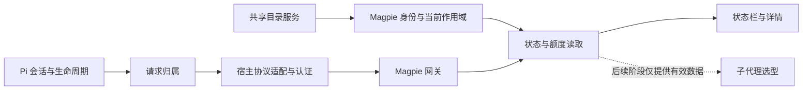

# Magpie 扩展规划设计

## 1. 文档范围

本文承接 [A00](A00.需求分析.md)，给出待确认的架构、数据口径与分期建议。术语见[名词解释](000.名词解释.md)，当前状态和证据位置统一见 [TODO](000.TODO.md)。具体代码落点及验证步骤归 [C00](C00.执行计划.md)。

协议判断以 §11 的固定源码为依据，不以当前上游分支推断现网。建议参数与界面入口均是本项目方案，不冒充 Magpie 的默认规则。

## 2. 边界与总体结构



| 职责 | 输入与输出 | 边界 |
| --- | --- | --- |
| 共享目录服务 | 目录快照、`isMagpie()`、当前作用域 | 沿用已有目录识别；不单独发身份探测。 |
| 请求归属 | 宿主会话、真实调用来源 → 追踪头／用途元信息 | 不改消息历史，不自建会话调度。 |
| 状态与额度读取 | 宿主认证、固定接口 → 原始快照与读取状态 | 不负责供应商账户登录、分流或重置权益消费。 |
| 额度投影 | 原始卡片 → 厂商／产品族分组、完整账户明细 | 底部仅显示有效 OpenAI 账户的最高已知比例；保留来源与完整明细，不求和或平均。 |
| 展示 | 会话状态、账户读数 → 宿主 UI | 不在无 UI 场景启动服务器或写个人明细日志。 |
| 后续分析 | 已标明质量的数据 → 路由、统计或选型参考 | 不覆盖原有硬约束，不自动调起任务。 |

新增功能按 M0～M3 独立装配。M0 不向模型上下文自动注入整份账户资料，也不新增模型可调用工具；是否需要 deferred 只读查询工具另行决定。

## 3. 启用与作用域

- 当前规范化网关地址和宿主凭据对应的共享目录已识别为 Magpie，才进入新增能力。
- 复用现有服务的作用域和失效机制；不增加一个与目录不一致的独立“是否 Magpie”布尔配置。
- 单接口的 401、403、404、超时分别处理；不得据此直接清除目录已确认的网关身份。
- 目录成功响应不再具备特征，或地址／凭据切换时，新功能停止使用旧作用域快照。
- 历史成功不代表当前实例仍支持对应接口；能力结果仅在当前作用域内使用。
- 既有 `AH-*`、`X-Magpie-Session` 追踪保持原有开关契约；新增 Magpie 专属元数据另受身份判断约束。

## 4. Magpie → Pi：输出契约

### 4.1 接口分工

| 接口 | 请求位置 | 输出用途与边界 | 分期 |
| --- | --- | --- | --- |
| `GET /v1/models` | 普通目录请求 | 模型及 Magpie 特征；沿用已有目录通路。 | 基础 |
| `GET /v1/magpie/statusline?format=json&session=<ID>` | 会话 ID 在 URL，进行 URL 编码 | `text`、`model`、`accounts`；模型可能回退为请求名，无回退标志，不能据此确认实际成员；不是完整资源。 | M0 |
| `GET /v1/magpie/quotas/cards` | 普通 GET | 缓存卡片，保留窗口、读数、错误、来源及可用的路由辅助字段。 | M0 |
| `POST /v1/magpie/quotas/refresh` | 不带账户筛选；不要求 `{all:true}` 正文 | 明确请求刷新可见卡片，随后返回卡片。 | M0 |
| 同一刷新 POST，带 `provider` 和可选 `user` | URL 查询参数，值必须编码 | 按 provider 和不区分大小写的 user 匹配；user 空值覆盖该 provider 全部账户，同名多卡可共同受影响；保留完整 provider。 | M0 |
| `GET /v1/magpie/quotas?kept=1` | URL 查询参数 | 缓存额度报告；用于结构对照或独立扩展，不作为卡片失败后的静默降级。 | 对照 |
| `GET /v1/magpie/quotas` | 普通 GET | 可能触发网关读取，刷新语义不够单一；首期不用于自动查看。 | 暂不采用 |
| `GET /v1/magpie/route?session=<ID>` | URL 查询参数 | 最新会话路由；后续可按接口支持使用 `after/wait`，首期不长轮询。 | M2 |
| `GET /v1/magpie/usage`、`GET /v1/magpie/usage/requests` | 时间范围、筛选、分页在 URL | 用量与请求记录，按原生／网关等来源区分。 | M2 |
| `GET /v1/magpie/limit` | 普通 GET | 网关密钥自身限制；不是供应商订阅总余额。 | M2 |

`POST statusline` 的正文 `session_id` 是另一种查询方式，不用于上报名称、父子关系或工作目录。M0 统一采用 GET，避免混淆查询与元数据上报。statusline 优先取路由的 `Model`，为空时回退 `Asked`，但输出不区分这两种来源；即便返回非空 `model`，界面也只称为网关状态报告值。

`/quotas/cards` 与 `/quotas?kept=1` 有相近的缓存来源，但前者返回卡片结构，后者转换为额度报告并加工部分字段；不能共用一个未经区分的解码类型。卡片接口返回错误时不自动再试报告接口，避免掩盖权限或结构差异。

### 4.2 模型响应

| 位置 | 字段 | 解释 |
| --- | --- | --- |
| HTTP 响应头 | `X-Magpie-Provider` | 本次返回所对应的 provider 标识。 |
| HTTP 响应头 | `X-Magpie-Model` | 网关成员模型标识。 |
| 模型响应正文 | `model` | 命名可能受网关策略影响，不能单独作为实际成员证据。 |

读取响应头依赖宿主适配器和传输方式；缺失则报告未取得，不自行解析流或替换协议适配器。首期不发送 `X-Magpie-Response-Model` 改变正文命名。

## 5. 额度数据与分组

### 5.1 保留源数据与时间

原始接口对象按接口类型保留，展示模型另行派生。仅在入口完成必要解析，不在内部重复校验同一份值。

- 账户层保留完整 provider、账户、套餐、类型、来源、余额及单位／组成、估算或共享余额标记、错误、`readAt/asOf`、`readDeferred`、重置权益，以及接口实际提供的其他语义字段。
- 窗口层保留名称、原始数值、文本标记、`display`、无限额、总量／已用量／余额及单位、重置时间；不套用第三方插件只含五个窗口字段的 UI 类型。
- 插件获取时间与逐卡片读数时间分开保存；从缓存读取不重置读数时间。
- 数值零、字段缺失、文本未知、读取失败和“没有主动读取”不能合并为同一状态。
- 展示读数优先处理无限额和 `display`。只有确认是有效百分比且不是文本占位时才计算剩余比例；积分、金额和百分比分别处理。
- 重置时间和重置权益到期时间分别标注；列出权益不代表可以消费。

### 5.2 厂商／产品族视图

层级为“厂商／产品族 → 来源 → 账户／套餐 → 窗口”。已知产品族可归到明确厂商；多厂商渠道或无法确认的 provider 保留自身分组，不按名称猜厂商。

`provider/user` 是刷新选择器，不是唯一卡片 ID；同一 provider、同名账户仍可能对应多张独立卡片。内存和 UI 不得以该二元组覆盖记录；刷新操作按协议匹配范围表达，不承诺仅影响一张卡片。

同账户多来源先保留全部源记录。仅在产品族、账户身份和套餐／窗口含义一致时建立可解释的逻辑关联；没有稳定全局账户 ID 时，同名仅提示可能重复，不自动删除或相加。

底部仅显示 OpenAI 的最高已知剩余比例：每张 OpenAI 账户卡先取共同限制窗口的最低值，再取账户最大值。按已确认的 codex 产品标识纳入本地和远程账户，不按名称猜厂商；其他厂商及余额仅在详情展示。停派、缺少读取密钥的账户不参与最大值；独立通道、文本占位和额外消费行不当作共同限制。优先使用无错误且未标旧的读数；只有有效旧值时加旧标记。OpenAI 无有效百分比、尚无读数或首次读取失败时隐藏额度项，不显示未知或失败占位；0% 是有效读数，仍须展示。金额不转换为百分比或跨账户求和；该比例是快捷比较指标，不代表可调用次数或实际路由保证。

选取较新重复读数只影响摘要，详情仍保留各来源的原始值、时间和错误。窗口缺失不能用另一来源中语义不明的窗口补成“完整额度”。

## 6. 读取与刷新策略

以下 M0 参数已随首期方案确认，不是网关协议默认值。最终任务边界按宿主公开的 `agent_settled` 实现；`agent_end` 后仍可能自动重试或续跑，不作为活动读取触发点。

| 触发 | 动作 | 限制 |
| --- | --- | --- |
| 启动、仅确认网关身份 | 不新增额度查询 | 不阻塞启动；等待实际任务或用户打开界面。 |
| 使用匹配网关根地址的 `tsgw` 模型，且用户正常任务最终完成后的 `agent_settled` | 异步 GET cards，更新全局底部摘要 | 同作用域 60 秒复用及失败抑制；不在每个工具结果或 `turn_end` 后读取；其他 provider 不触发。 |
| 切换会话或模型、同进程新建界面实例 | 复用并订阅当前网关和凭据的全局卡片快照 | 不因切换清空读数，不发启动查询；作用域失效停止展示旧数据。 |
| 打开会话状态详情 | GET statusline，携带真实会话 ID | 仅用于会话详情；其筛选账户和省略余额卡的行为不能用作全局摘要。 |
| 打开额度详情 | GET cards | 同作用域成功快照 60 秒复用，并发调用共用进行中的请求。 |
| 用户选择“重新读取卡片” | 绕过插件复用窗口，GET cards | 仍然只读网关缓存。 |
| 用户选择“刷新上游额度” | 一次 POST refresh | 全部或已说明的 provider／user 匹配范围；可能多卡，用户明确触发，无定时器。 |
| 空闲、退出、生命周期失效 | 不发新查询 | 会话不再接收异步 UI 更新。 |

GET 建议 5 秒超时；上游刷新建议 35 秒总预算，以覆盖固定源码中的 30 秒网关等待。调用可取消，不自动重试、换端点或重新刷新。取消不保证已开始的远端刷新停止。

只设置请求截止时间，不设置定期刷新任务。活动读取的 60 秒抑制按最近一次请求尝试计算，失败不提升成功快照或源读数的新鲜度；用户显式操作可绕过该抑制。自动活动读取不主动刷新供应商；M0 不读取整份卡片作为每轮任务的前置条件。

并发读取共享快照；同目标或覆盖其范围的在途刷新可复用结果。不同目标刷新进行中时提示当前操作未完成，不建立后台刷新队列；用户重复刷新不会新增隐式周期。普通读取遇到刷新进行中时复用该结果，失败仍保留旧值并单独标明错误。

## 7. 认证、兼容与失败语义

- 模型和查询请求沿用宿主公开认证解析，地址沿用当前 provider 的规范化根地址；不直接解析个人凭据文件，不新建认证优先级。
- 新查询仅由获准的活动触发或显式操作发起，并遵守宿主实际存在的联网限制。已核对的 `allowNetwork` 是目录刷新上下文，不是通用 HTTP 权限 API；不调用目录刷新来探测查询权限，也不虚构额外审批服务。
- 不照搬 DSH 插件的线路、Cloudflare 凭据或浏览器转发层，不增加多网关管理。
- 首期仅内存保存额度和会话状态，不新增个人账户明细磁盘缓存或配置项。
- 缺少所需公开 hook 或认证接口时，仅对应功能不可用；不擅自提高项目最低宿主版本。`traceHeaders: false` 继续关闭追踪补充，不等价于禁用模型目录或手动状态查看。

| 结果 | 行为 |
| --- | --- |
| 401 | 当前能力停止自动请求，提示认证失败，不展示旧的受限账户明细；凭据作用域改变或用户显式重试后才重新读取。 |
| 403 | 当前接口停止自动请求，标明无权限且不展示旧受限明细；其他能力保留，显式重试可重新核对。 |
| 404／405 | 当前接口停止自动请求，标明入口不可用；显式重试或作用域变化后重查，不反推身份、不静默换接口。 |
| 超时／网络错误／不可解析响应 | 保留上次成功快照及读数时间，另标本次失败；聊天继续。 |
| HTTP 200 但读数时间未变 | 标为读数未变化，不断言必然是节流；不把获取时间写成读数时间。 |
| 某条记录有错误或缺读数 | 保留记录与未知状态，不以“剩余 100%”代替。 |

普通日志不记录地址、凭据或敏感原始响应；个人账户资料只在明确请求的本机详情中展示。测试使用合成身份。

## 8. Pi → Magpie：输入契约与用途方案

### 8.1 信息准确放置

| 信息 | 放置位置与添加入口 | 处理方案 |
| --- | --- | --- |
| 真实会话 ID | HTTP 头 `X-Magpie-Session`；`before_provider_headers` 修改 `event.headers` | 继续取 `ctx.sessionManager.getSessionId()`；保留已有同名头。 |
| 客户端身份 | HTTP 头 `User-Agent` | 沿用真实宿主身份，不伪装成 Codex、Claude 或网关内部组件。 |
| 工作目录 | 请求正文的系统提示文本，例如 `<cwd>…</cwd>` | 复用宿主已有文本与网关识别，不新增目录头或改消息历史。 |
| 标准压缩 | 请求正文的标准压缩系统提示 | 复用网关已有 `compact` 内容识别；自定义压缩单独核对。 |
| 显式用途 | 候选为 HTTP 头 `x-codex-turn-metadata` 的 JSON `thread_source`；亦有顶层 `client_metadata` 入口 | 推荐优先验证请求头方案，避免把非标准正文元数据加到不同供应商协议。 |
| 真实标题 | 当前已有来源是 Pi 本地文件的 `session_info.name` | 不等于 HTTP 可上报字段；远程标题暂不补写，不自动重命名。 |
| 父子关系 | 来源于宿主子会话元数据；网关接收规则另行判断 | 先保留真实关系，不假设 `parent_thread_id` 可泛化表达。 |

系统提示的最终协议位置为 Chat 的 `messages`、普通 Responses 的 `input`、Codex 的 `instructions`、Anthropic 的 `system`，继续由宿主适配。

`client_metadata` 是 HTTP 请求 JSON 最外层字段。若后续选择正文方案，只能通过 `before_provider_request`／独立调用 `onPayload` 做最小 copy-on-write，保留其他字段及引用；不塞进每条消息的 `metadata`。

### 8.2 用途字段建议

聊天请求主入口会解析上述用途元数据，不要求客户端必须是 Codex，也没有排除 Pi；该结论不适用于所有 HTTP 端点，原生分类的独立决策入口见下表。部分后续 hook 仍检查客户端身份，不能把“解析成功”当作全部行为已兼容。

| 调用 | 建议标记 | 边界 |
| --- | --- | --- |
| 普通任务 | 不新增用途标记 | 网关未标记桶为 `unmarked`，不发送 `task`。 |
| 标准压缩 | 保留已有内容识别 | 不为识别而重写压缩材料。 |
| 插件搜索 | `thread_source: "web_search"` | 仅候选映射；须核对透传与界面行为后启用。 |
| 插件聊天选型（三路聊天通道） | `thread_source: "routing"` | 候选映射；不改变竞速、调用次数、候选与档位。 |
| 原生分类 | 仅补独立追踪身份，不发送候选用途头 | 当前 `/v1/systemone` 接收路径不读取 `requestCallKind`，对应记录未填写 Kind；不能靠该头实现 routing 分类。 |
| 真实子代理 | 暂不指定通用标记 | 不把 Claude agent 层级直接套成 Pi 独立会话；不冒用 `collab_spawn` 触发 Codex 专属行为。 |

候选请求形状如下，属于待验证方案，不是当前插件已发出的请求：

```http
X-Magpie-Session: <辅助请求的独立追踪ID>
x-codex-turn-metadata: {"thread_source":"web_search"}
```

启用条件：确认实际网关读取该字段、后续代理不会产生不兼容透传、Pi 各协议仍能正常请求，且用途和会话展示符合预期。正文已有有效 `client_metadata` 时可能优先于投影请求头；保留既有标记，不能仅补一个头就断言用途生效。条件未满足时不启用候选元数据，不通过修改 `User-Agent` 绕过。

### 8.3 身份与父子关系

- 主任务和真实子会话各用真实宿主 ID；普通 fork 继续独立。
- 搜索、选型没有独立宿主会话时，建议每次实际模型请求生成独立辅助请求 ID；四路选型各有请求 ID，本地关联同一发起操作，不称为四个真实子会话。
- 发起会话与辅助请求的关系可用于本地诊断，不自动发送新父会话字段。
- 网关 `titleParentSession` 只对标题类用途归组；不能用于搜索、选型或任意子代理。标题本身也不在首期新增。
- Remote Magpie 的 Agent／Via／Hops 等中继头属于中继身份，不整组照搬给普通 Pi 客户端。

### 8.4 hook 覆盖边界

| 调用路径 | 请求头 | 顶层正文／响应 |
| --- | --- | --- |
| 普通会话 | `before_provider_headers` | `before_provider_request`、`after_provider_response`。 |
| 宿主标准压缩 | 当前调用链覆盖请求头 hook | 不保证自动携带主会话的正文／响应回调；需独立验收。 |
| 插件搜索、聊天选型 | 独立调用 options 的 `headers` | 使用并组合现有 `onPayload`、`onResponse`；不假设继承全局 hook。 |
| 原生分类 | ProviderRequestOptions 的 `headers` | 公共 options 支持相应回调；插件适配是否完整消费须验证。 |

## 9. M2：路由与用量

先读取当前会话最新路由及受限范围内的统计，不自动扫描全部历史、不常驻长轮询。响应头只提供本次已返回成员证据，完整尝试过程由 route 查询承担。

同一真实会话有多个并发请求时，route 只称为“会话最新路由”，不能伪装成每条消息的精确链路。用量视图保留时间范围、统计来源、账户范围及已知缺口；消费金额与公开模型价格、网关记账和供应商账单分别说明。

## 10. M3：额度辅助选型

M3 先定义有效读数判定和建议展示，再决定是否修改选择器。缺少新鲜、完整且可映射到候选模型的数据时不参与选择。

能力、用户显式模型与固定审阅组合优先；额度不能降低硬约束。只在任务适用且约束相同的候选之间提供资源参考，不设无依据的统一分数。临近重置或权益到期只产生提示，不自动开始任务、消费权益或多派子代理。

任何自动策略变更必须先补齐独立的阈值依据、模型适用关系、失败语义及验收方案，不因批准 M0 顺带修改四路竞速。

## 11. 依据、备选与取舍

| 证据 | 固定来源 | 支撑范围 |
| --- | --- | --- |
| E1 | [Magpie gateway.go](https://github.com/yetone/magpie/blob/3173c4f41e29871bfdfbb887b98ea930bf83eb5b/internal/gateway/gateway.go)、[quotas_scope.go](https://github.com/yetone/magpie/blob/3173c4f41e29871bfdfbb887b98ea930bf83eb5b/internal/gateway/quotas_scope.go) | 接口注册、卡片、显式刷新、权限及节流。 |
| E2 | [session_parent.go](https://github.com/yetone/magpie/blob/3173c4f41e29871bfdfbb887b98ea930bf83eb5b/internal/gateway/session_parent.go)、[purpose.go](https://github.com/yetone/magpie/blob/3173c4f41e29871bfdfbb887b98ea930bf83eb5b/internal/usage/purpose.go) | 通用元数据解析、标题父线程限制、用途目录。 |
| E3 | [quotas.go](https://github.com/yetone/magpie/blob/3173c4f41e29871bfdfbb887b98ea930bf83eb5b/internal/provider/quotas.go)、[subscription_usage.go](https://github.com/yetone/magpie/blob/3173c4f41e29871bfdfbb887b98ea930bf83eb5b/internal/provider/subscription_usage.go)、[member.go](https://github.com/yetone/magpie/blob/3173c4f41e29871bfdfbb887b98ea930bf83eb5b/internal/gateway/member.go) | 报告／卡片结构、读数时间、响应成员头。 |
| E4 | [DSH cards.ts](https://github.com/prgrmrwy/dsh-magpie-connector/blob/fad46c2a9b7d0619f21d3d0ba9d3e6ff622a3481/src/host/cards.ts)、[sidebar-api.ts](https://github.com/prgrmrwy/dsh-magpie-connector/blob/fad46c2a9b7d0619f21d3d0ba9d3e6ff622a3481/src/client/sidebar-api.ts)、[SidebarUsage.ts](https://github.com/prgrmrwy/dsh-magpie-connector/blob/fad46c2a9b7d0619f21d3d0ba9d3e6ff622a3481/src/client/SidebarUsage.ts) | 读取／刷新分离、并发合并、缓存、定时刷新和精简投影的参考。 |
| E5 | 本机 Pi 1.5.2 的 extensions 文档、SDK 和 ProviderRequestOptions；本项目源码入口见 C00 | hook 能力与实际覆盖；不代表最低支持版本均已验证。 |
| E6 | [statusline.go](https://github.com/yetone/magpie/blob/3173c4f41e29871bfdfbb887b98ea930bf83eb5b/internal/gateway/statusline.go)、[quota_refresh.go](https://github.com/yetone/magpie/blob/3173c4f41e29871bfdfbb887b98ea930bf83eb5b/internal/provider/quota_refresh.go)、[cards_kept_test.go](https://github.com/yetone/magpie/blob/3173c4f41e29871bfdfbb887b98ea930bf83eb5b/internal/provider/cards_kept_test.go) | 状态模型名回退、刷新匹配范围、同名多卡证据。 |
| E7 | [decide.go](https://github.com/yetone/magpie/blob/3173c4f41e29871bfdfbb887b98ea930bf83eb5b/internal/gateway/decide.go)、[decide_group.go](https://github.com/yetone/magpie/blob/3173c4f41e29871bfdfbb887b98ea930bf83eb5b/internal/gateway/decide_group.go) | 原生分类独立入口的会话追踪与用途缺口；不外推聊天入口能力。 |

历史只读实例结果：models、quotas、kept、statusline 曾成功；较晚一次根路径及 route 返回 401。cards、refresh、usage、limit 未做当前实例验收。历史成功与失败均不是当前可用性的永久结论。

选择卡片接口是为了让普通查看与供应商刷新有明确边界；不把普通 quotas GET 当作自动读取入口。参考 DSH 的数据层做法，但不引入其认证、线路、定时刷新和精简字段集。

## 12. 待确认决策

| 决策 | 建议 | 确认影响 |
| --- | --- | --- |
| Q1：首轮实施范围 | M0；M1 已证实部分另列批次；M2/M3 后续单独确认 | 确定 C00 可执行的工作包。 |
| Q2：活动读取 | 用户已确认：正常任务结束后异步 GET cards，全局 60 秒复用；会话 statusline 保留在显式详情 | 底部仅显示 OpenAI 最高已知剩余比例，其他厂商及余额留在详情；切换会话保留共享读数，不增加启动或空闲请求。 |
| Q3：操作入口 | 扩展现有 `/tsgw` 菜单，保留模型目录功能；不新增模型工具 | 决定用户交互与公开接口范围。 |
| Q4：M1 用途方案 | 优先验证 HTTP 头方案；标题和通用父子上报暂不实现 | 验证失败则保留明确缺口，不新增协议补洞。 |
| Q5：现场验收 | 与离线实现分别授权；明确 GET／POST／付费推理范围 | 文档确认不自动授权部署、刷新供应商或付费测试。 |

确认后的范围及本轮证据写回 TODO；实质修改上述方案后重新提交确认，不沿用旧版本批准。
